

# R E V I E W

**See how you really play ranked — and how far you are from the next rank.**

**[⬇ Download for Windows](../../releases/latest)** · free · no install

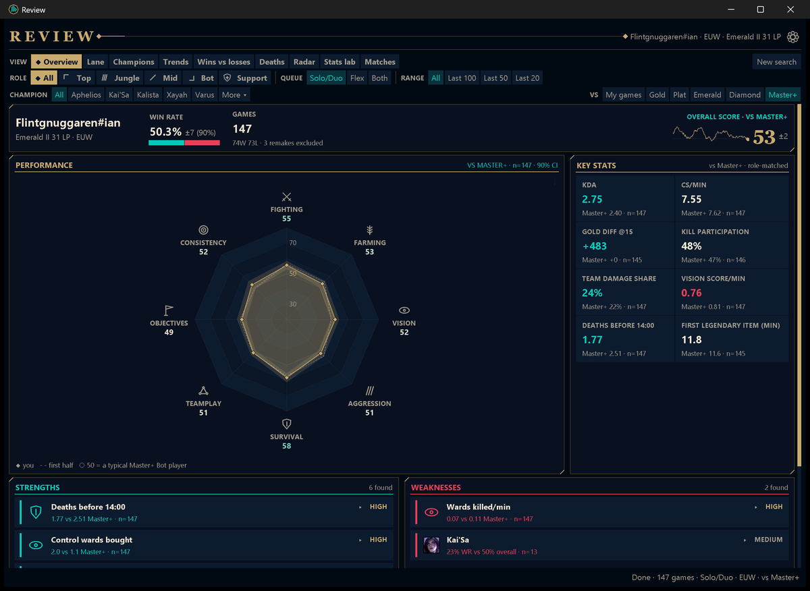

Type a Riot ID and Review reads your last ranked games straight from Riot. It scores eight skills against players in your role, finds what you do better and worse than them, and gives one concrete thing to work on. Pick **Gold, Plat, Emerald, Diamond or Master+** and every chart shows where that rank sits — or add your friends and see who's better at what. Every number comes from real games and says how sure it is. *(Click any picture to enlarge.)*

<table>
<tr>
<td width="50%" valign="top"><b>Performance radar</b> Eight skills, each scored against players in your role. 50 is the average of the rank you compare with.  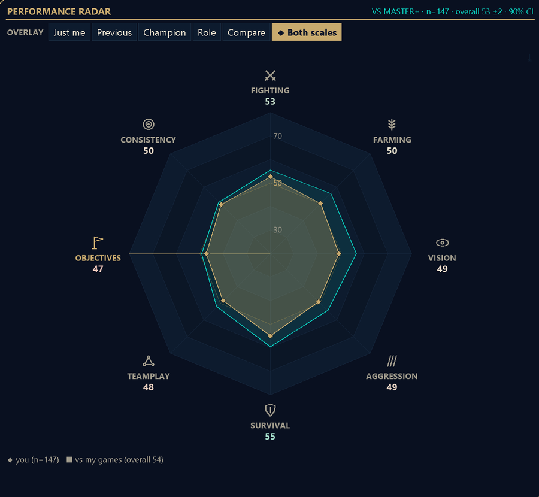</td>
<td width="50%" valign="top"><b>Click any skill</b> What it is made of, how it changed, your best and worst games — and what to work on.  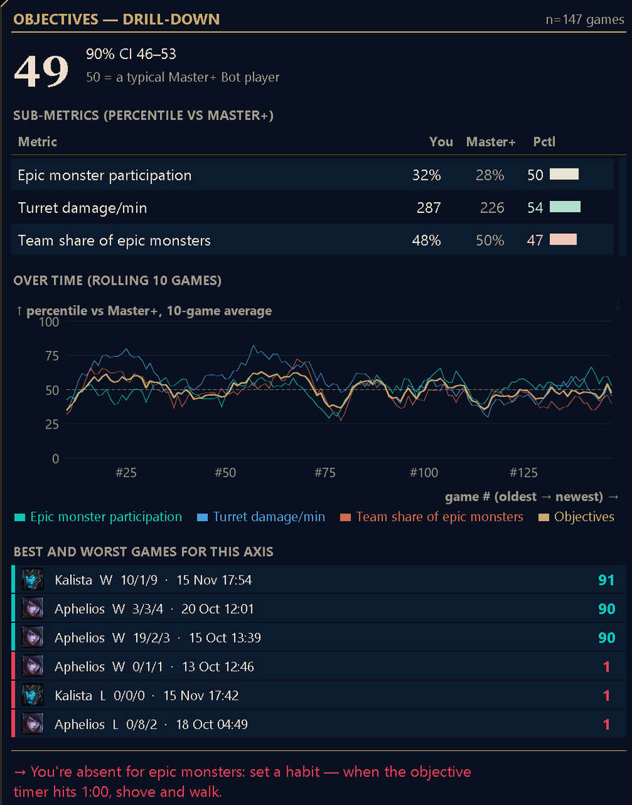</td>
</tr>
<tr>
<td width="50%" valign="top"><b>Compare with your friends</b> NEW Add up to five Riot IDs: radars on top of each other and who's first, all on one rank's scale.  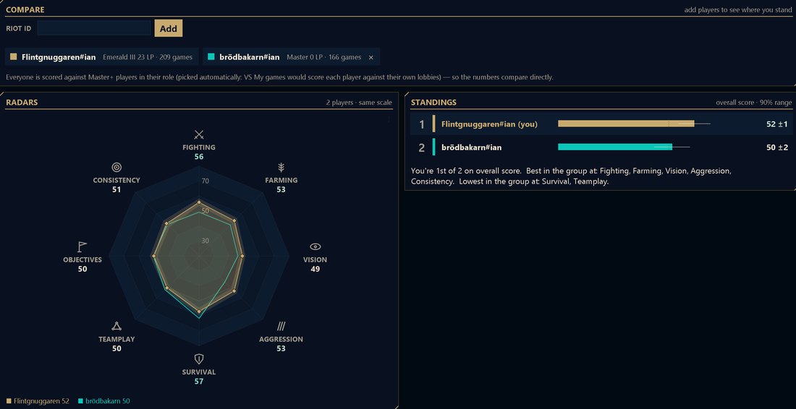</td>
<td width="50%" valign="top"><b>Head to head</b> NEW Every skill and stat side by side. Teal is the best in the group, red the lowest.  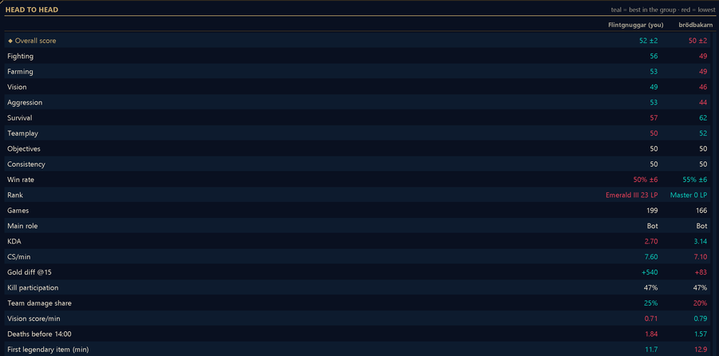</td>
</tr>
<tr>
<td width="50%" valign="top"><b>Compare with any rank</b> A dashed line shows where the rank you picked is. Verdicts only appear when a change is real.  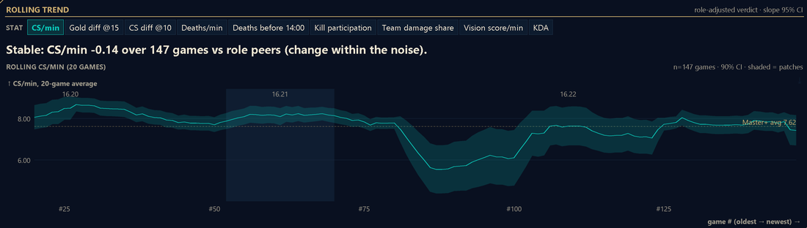</td>
<td width="50%" valign="top"><b>Your champions</b> Win rate, KDA, CS and gold vs your opponent for every champion. ◆ marks your best picks.  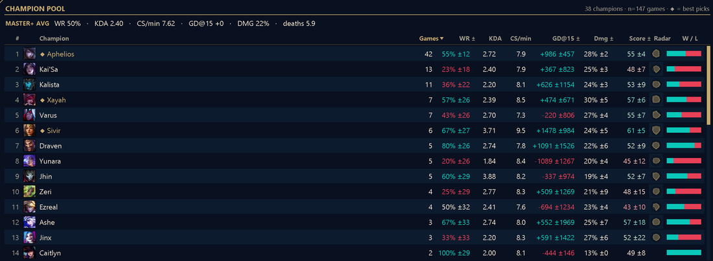</td>
</tr>
<tr>
<td width="50%" valign="top"><b>What decides your games</b> The stats that differ most between your wins and your losses.  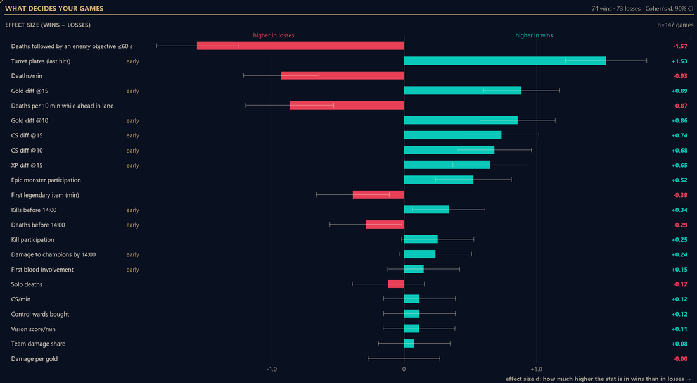</td>
<td width="50%" valign="top"><b>Where you die</b> Every death on the map, by game phase, and what it cost your team.  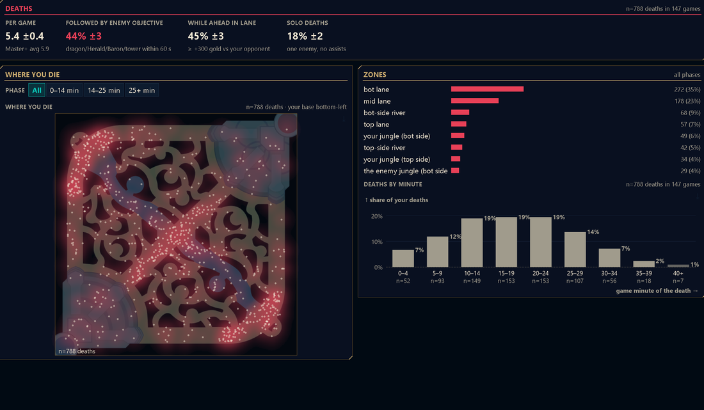</td>
</tr>
<tr>
<td width="50%" valign="top"><b>Lane phase</b> Gold, CS and XP against your direct opponent, minute by minute, in wins and losses.  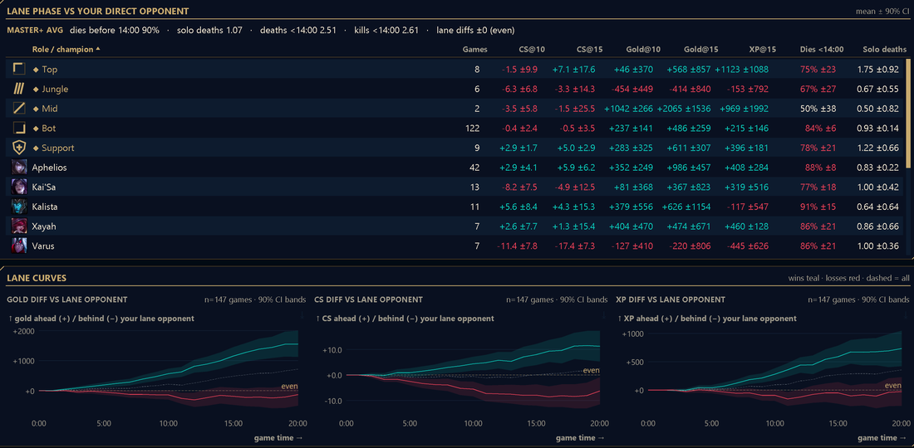</td>
<td width="50%" valign="top"><b>Tilt</b> Your win rate after one, two and three losses in a row.  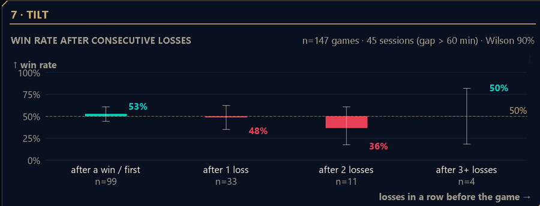</td>
</tr>
<tr>
<td colspan="2" valign="top"><b>Every game</b> Open any match: gold curve against your laner, your deaths on the map and that game's radar.  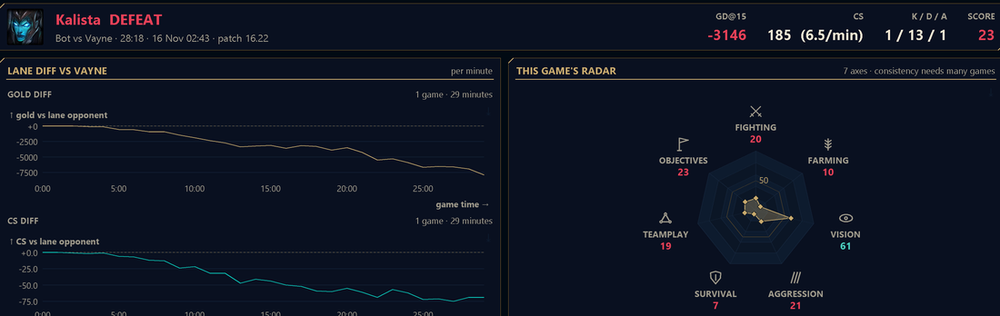</td>
</tr>
</table>

## Install

1. Download `Review-v1.1-windows.zip` from the [latest release](../../releases/latest) and unzip it.
2. Run `Review.exe`. If Windows says *"protected your PC"*, click **More info → Run anyway** (the file isn't code-signed).
3. Type a Riot ID (`Name#TAG`), pick the region and press **Analyze**. The first time takes a few minutes while your games download — after that it's instant.

## How sure is it?

Every score is a percentile against real players in your role, game by game, so a support is never compared with an ADC. Small samples are pulled towards 50, so six games on a champion can't fake a 98, and every score carries a 90 % range. A strength or weakness only appears when it is clear in at least 20 games — no horoscopes.

## Good to know

All data comes from Riot's official API. The first time you pick a rank to compare with, Review downloads a sample of real games at that rank (10–15 minutes, once). Riot allows 100 requests every two minutes, so a first download is quicker when friends don't all start at the same time. Review runs on your computer and sends nothing to anyone but Riot.

Review isn't endorsed by Riot Games and doesn't reflect the views or opinions of Riot Games or anyone officially involved in producing or managing Riot Games properties. Riot Games and all associated properties are trademarks or registered trademarks of Riot Games, Inc.
