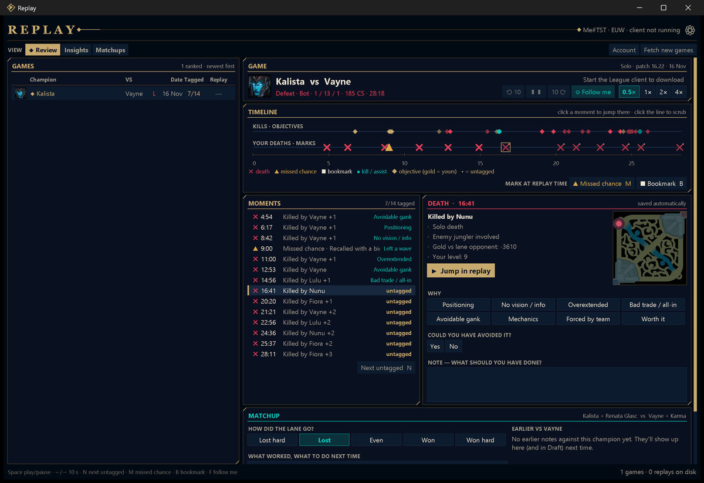
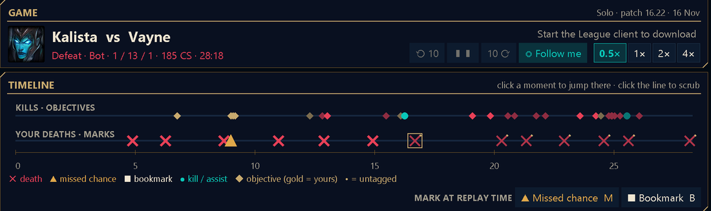
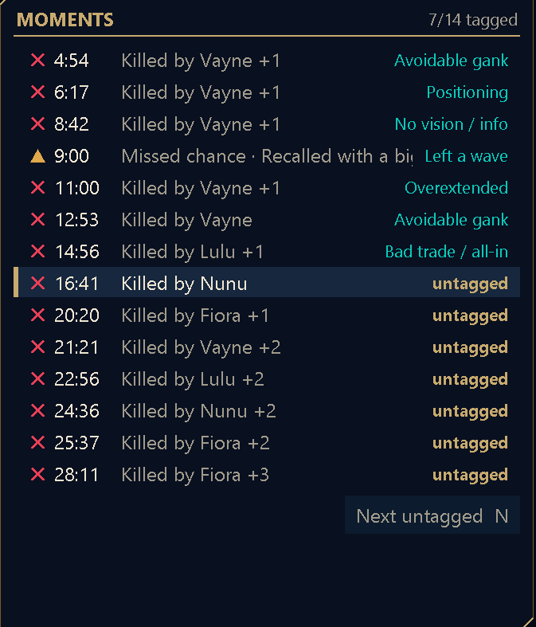
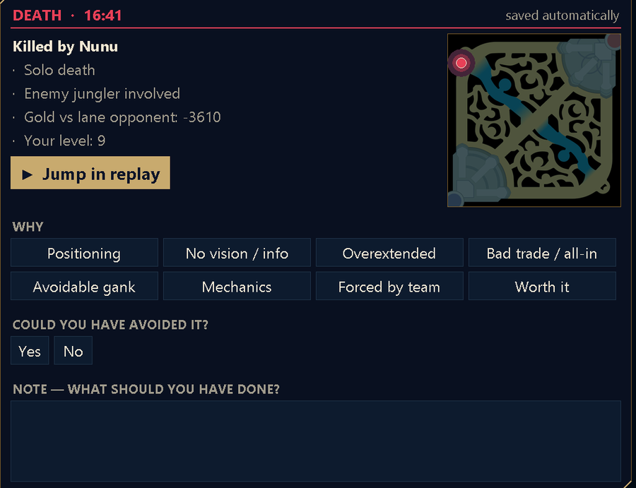
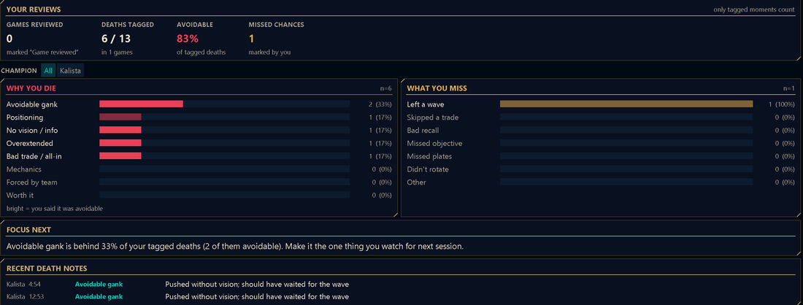
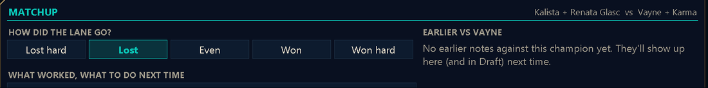

# R E P L A Y

**Watch your replays with a remote. Write down why you died.**

**[⬇ Download for Windows](../../releases/latest)** · free · no install

Replay sits next to League's own replay player. Pick a game and it lists every death, kill and objective; click one and the replay jumps there with the camera on you. Tag why each death happened, and after a few games Replay shows the pattern — the one thing to work on next session. *(Click any picture to enlarge.)*

<table>
<tr>
<td colspan="2" valign="top"><b>A remote for the replay</b> Play, pause, ±10 s, speed, and <i>Follow me</i> keeps the camera on your champion. Click any moment on the timeline to jump there.  </td>
</tr>
<tr>
<td width="50%" valign="top"><b>Every death, listed</b> Who killed you, with how many helpers. <b>N</b> jumps to the next one you haven't tagged.  </td>
<td width="50%" valign="top"><b>Tag why you died</b> Positioning, vision, gank, bad trade… and whether you could have avoided it. Saved as you click.  </td>
</tr>
<tr>
<td width="50%" valign="top"><b>Why you die</b> Your tags across every game, the deaths you called avoidable, and what to focus on next.  </td>
<td width="50%" valign="top"><b>Matchup notes</b> How the lane went and what to do next time. Draft shows them in champ select the next time you meet that champion.  </td>
</tr>
</table>

## Install

1. Download `Replay-v1.0-windows.zip` from the [latest release](../../releases/latest) and unzip it.
2. Run `Replay.exe`. If Windows says *"protected your PC"*, click **More info → Run anyway** (the file isn't code-signed).
3. Click **Account**, type your Riot ID (`Name#TAG`) and press **Fetch new games**.
4. Start the League client, pick a game and press **Watch** — Replay downloads the replay through the client and opens it.

## Good to know

The first time you press **Watch**, Replay switches on League's local replay API (one line in `game.cfg`; a backup is kept). Games come from Riot's official API and are shared with [Review](https://github.com/ianstanojevic/review), so anything Review has fetched is already here. Your notes stay on your PC and send nothing to anyone. Replays only work on the patch they were played on — tag a game the same day.

## The family

**[Draft](https://github.com/ianstanojevic/draft)** before the game · **Replay** right after · **[Review](https://github.com/ianstanojevic/review)** every week.

Replay isn't endorsed by Riot Games and doesn't reflect the views or opinions of Riot Games or anyone officially involved in producing or managing Riot Games properties. Riot Games and all associated properties are trademarks or registered trademarks of Riot Games, Inc.
